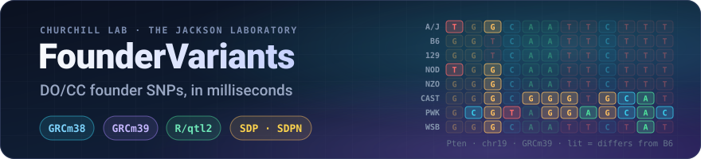
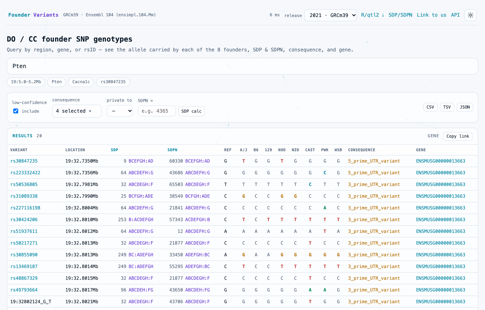

<p align="center">
  
</p>

<p align="center">
  <a href="https://churchilllab.jax.org/foundervariants"></a>
  
  <a href="https://kbroman.org/qtl2/"></a>
  <a href="https://hub.docker.com/r/churchilllab/foundervariants"></a>
  
  <a href="LICENSE"></a>
  
</p>

<p align="center">
  Built and maintained by the
  <b><a href="https://www.jax.org/research-and-faculty/research-labs/the-churchill-lab">Churchill Lab</a></b>
  at <b><a href="https://www.jax.org">The Jackson Laboratory</a></b>
</p>

<p align="center">
  <b><a href="https://churchilllab.jax.org/foundervariants">Live site</a></b> |
  <b><a href="docs/API.md">API</a></b> |
  <b><a href="docs/ARCHITECTURE.md">Architecture</a></b> |
  <b><a href="docs/DATABASES.md">Databases</a></b> |
  <b><a href="docs/DEPLOYMENT.md">Deployment</a></b> |
  <b><a href="src/foundervariants/web/static/LINKING.md">Linking</a></b>
</p>

---

**FounderVariants**, from the Churchill Lab at The Jackson Laboratory, answers one question fast: *what does each of the eight
Diversity Outbred / Collaborative Cross founders carry across this locus?* Ask by
region, gene or rsID and get every founder's base at every SNP, with its strain
distribution pattern, VEP consequence and gene. Results come back in milliseconds, as a
web UI, an HTTP API, or a Python library.

The data comes from the Sanger Mouse Genomes **VCFs**, reduced to the 8 founders and built
into **one compact, self-contained SQLite file per genome build**. That same file is also,
unchanged, a drop-in **R/qtl2** variant database.

<p align="center">
  <picture>
    <source media="(prefers-color-scheme: dark)" srcset="docs/assets/screenshot-dark.png">
    
  </picture>
</p>

## Why

- **One local file instead of a 24 GB scan.** Answering this from the source VCFs means
  reading ~24 GB. Here a region or gene query takes a few milliseconds, and even a
  genome-wide founder-pattern scan across all ~36 M SNPs takes about a second, from a single
  4.3 GB file per build.
- **The served file *is* the R/qtl2 database.** `create_variant_query_func(db)` works with
  no field overrides and no export step. The previous database was 11 GB, needed
  `id_field="variants_id"`, and needed a separate running service to resolve a gene symbol.
- **Founder-pattern queries.** "SNPs private to WSB", "sites where CAST and PWK differ",
  "every site matching this exact pattern": these are bit arithmetic on one stored integer,
  so they are cheap enough to offer in the UI.
- **Both mouse builds.** GRCm38 (Sanger REL-1505, Ensembl 75) and GRCm39 (REL-2021,
  Ensembl 104) are served side by side, with one consequence vocabulary across both.
- **Self-contained.** Gene-symbol lookup and autocomplete come from a `genes` table inside
  each database. No sister service, no network, no CDN.
- **Linkable.** Other sites (e.g. the Mouse Phenome Database's GWAS pages) can open the UI
  directly on a peak: `/?release=GRCm38&chr=10&pos=128350502`.
- **Small surface.** The query core is stdlib `sqlite3`, serving adds only FastAPI +
  uvicorn, and the CLI has two subcommands: `build` and `serve`.

## The 8 founders and the two encodings

The founder order is fixed (A–H): **A/J · C57BL/6J · 129S1/SvImJ · NOD/ShiLtJ · NZO/HlLtJ ·
CAST/EiJ · PWK/PhJ · WSB/EiJ**. C57BL/6J is the reference strain. It is not a sample in the
VCF and is always REF.

| encoding | from | what it is | range |
|---|---|---|---|
| **SDP** | Broman / R/qtl2 | 8-bit ref-vs-alt pattern, A/J = bit 0. What R/qtl2 needs. | 0–255 |
| **SDPN** | Vincent | 16-bit base-4 over A/C/G/T: the *actual* base each founder carries. Strictly more information than SDP, and the basis for the founder-pattern queries. | 0–65535 |

Only `sdpn` and `confidence` are stored. `sdp`, `ref`, `alleles`, per-founder bases and
per-founder confidence are all **derived on read** from those two values, and that is the
core compactness decision. [ARCHITECTURE](docs/ARCHITECTURE.md#2-encodings) has worked
examples of both encodings, and the UI has an **SDP calc** pop-up plus an `/sdp` page that
explain the calculation interactively.

## Install

Requires **Python 3.12+** and **[uv](https://docs.astral.sh/uv/)**.

```bash
git clone https://github.com/churchill-lab/foundervariants.git
cd foundervariants
uv sync                    # query + serve: fastapi, uvicorn (the query core is stdlib)
uv sync --extra build      # + cyvcf2, only on a machine that builds databases from VCFs
```

The databases are **not in the repository** (each is ~4.3 GB). Either build them from the
Sanger VCFs ([below](#build-a-database)) or copy existing ones into `dbs/`.

## Quickstart: web UI and API

```bash
uv run foundervariants serve --dir dbs
```

Open **http://127.0.0.1:8000/** for the UI or **/docs** for the interactive API reference.
Releases are discovered from whatever `fv.*.snps.sqlite` files are in `--dir`, so there is no
manifest. To add or remove a release, add or remove its file and restart.

```bash
curl 'http://127.0.0.1:8000/2021/variants?gene=Pten&consequence=missense_variant'
curl 'http://127.0.0.1:8000/2021/variants?region=19:5.0-5.2Mb&private_to=WSB_EiJ&format=csv' -o wsb.csv
```

## Quickstart: library

Each `.sqlite` file can be queried without the server. It is the same engine the API uses,
with nothing installed beyond the standard library:

```python
from foundervariants import query

con = query.connect("dbs/fv.2021.snps.sqlite")        # read-only + immutable
res = query.search_variants(con, gene_symbol="Pten", consequence="missense_variant")
for v in res["variants"]:
    print(v["variants_id"], v["founders"], v["sdpn_display"], v["max_csq"])

hits = query.genes_search(con, "Pt", limit=5)          # symbol autocomplete
info = query.meta(con)                                 # provenance dict
```

Other functions are `gene`, `so_terms` and `decode`. All return plain dicts and lists.

## Quickstart: R/qtl2

```r
library(qtl2)
qv  <- create_variant_query_func("dbs/fv.2021.snps.sqlite")
res <- qv("19", 5.0, 5.2)     # start/end in Mbp; pos is stored in bp and returned in Mbp
idx <- index_snps(map, res)   # groups by sdp for scan1snps
```

It uses the canonical column names (`snp_id`, `chr`, `pos`, `alleles`, `sdp`), so that one
call is all R/qtl2 needs. This has been verified at full scale in real R on both builds; see
[DATABASES.md](docs/DATABASES.md#validation).

## Selecting and filtering variants

`GET /{release}/variants` takes exactly one **selector** and any number of **filters**.
`{release}` is `2021` (GRCm39) or `1505` (GRCm38).

| parameter | example | meaning |
|---|---|---|
| `region` | `19:5.0-5.2Mb` | a range in bp, or with `kb`/`Mb` suffixes (selector) |
| `gene` | `Pten` | a gene symbol, resolved locally to its span (selector) |
| `rsid` | `rs30847235` | a single dbSNP id (selector) |
| `consequence` | `missense_variant,stop_gained` | carries *any* of these terms, as one bitwise test against `csq_mask` rather than a join |
| `low_confidence` | `true` | include sites where some founder's Sanger `FI` flag is low (the default is high-confidence only) |
| `private_to` | `WSB_EiJ` | that founder differs from all seven others |
| `differ` | `CAST_EiJ,PWK_PhJ` | those founders carry different bases |
| `sdpn` | `43682` | an exact strain-distribution pattern |
| `format` | `csv` · `tsv` · `json` | download the result as a file, with one column per founder |

Other endpoints are `/health`, `/genomes`, `/{release}/meta`, `/{release}/so_terms`,
`/{release}/genes?q=Pt` (autocomplete) and `/{release}/download/rqtl2` (the database file
itself). The full reference is in [docs/API.md](docs/API.md), with curl, Python and R examples.

## Build a database

Each build reduces one Sanger release to the 8 founders and writes
`dbs/fv.<release>.snps.sqlite`. Nothing about releases is hardcoded: you pass the VCF, the gene
annotation and the assembly.

```bash
uv sync --extra build

uv run foundervariants -v build \
  --vcf /path/to/Sanger/REL-2112-v8-SNPs_Indels/mgp_REL2021_snps.rsID.vcf.gz \
  --genes-tsv ../data/ensimpl.104.mm.genes.tsv \
  --so-tsv    ../data/so_terms.tsv \
  --release 2021 --grc GRCm39 --gene-version "Ensembl 104 (ensimpl.104.Mm)" \
  --out dbs
```

A whole genome takes **~50 minutes** in one streaming pass, writing one output file with no
intermediates. Add `--chroms 19` to build a single chromosome in about a minute, which is the
right way to check a pipeline change.

Things to know before you build:

- **The gene TSV must match the assembly**, not merely be newer. GRCm38 variants with GRCm39
  gene coordinates produce a database that looks fine but answers `?gene=` wrongly.
- **Row order in `so_terms.tsv` is load-bearing.** It assigns each SO term its bit in every
  variant's `csq_mask`, so append new terms at the end and never reorder them.
- **Deprecated VEP terms are canonicalized at parse time**, so one vocabulary spans every
  release. For example, VEP 75's `initiator_codon_variant` becomes VEP 104's `start_lost`
  ([why](docs/DATABASES.md#deprecated-vep-terms-are-canonicalised-on-read)).
- **Each database describes itself.** Source VCF, gene annotation, assembly and build tool are
  recorded in its `meta` table: `sqlite3 dbs/fv.2021.snps.sqlite "SELECT * FROM meta"`.

[DATABASES.md](docs/DATABASES.md) has the full provenance: source VCFs, what gets filtered and
why, the exact commands, and how each database was validated against the legacy one.

## Databases

| release | build | file | variants | chromosomes |
|---|---|---|--:|---|
| 2021 | GRCm39, Ensembl 104 | `fv.2021.snps.sqlite` (4.27 GB) | 35,805,856 | 1–19, X |
| 1505 | GRCm38, Ensembl 75 | `fv.1505.snps.sqlite` (4.27 GB) | 36,218,870 | 1–19, X, Y, MT |

Each file is a single artifact that is both served by the API **and** read by R/qtl2. It
replaces an 11 GB legacy database: the 110 M-row transcript-level consequence table is folded
into a per-variant bitmask instead of being stored. GRCm39 has no Y or MT because the source
VCF has none.

## Deploy

The image contains only the app. Databases are mounted **read-only** at runtime, so one image
serves any set of releases.

```bash
cp .env.example .env               # then adjust
docker compose up --build -d       # local: build from source and run
```

On a server, `compose.prod.yaml` pulls the published image
(`churchilllab/foundervariants`) and never builds, so the host needs no source checkout: just
that file, a `.env`, and the databases. Behind a path-stripping reverse proxy, set
`FV_BASE_PATH` to the prefix (e.g. `/foundervariants`). `apache-foundervariants.conf` holds
the matching Apache config.

[DEPLOYMENT.md](docs/DEPLOYMENT.md) is the full walkthrough. It covers local setup, verifying
databases in R, building and publishing images, copying multi-GB databases safely, Apache,
update/rollback, and troubleshooting.

## Configuration: environment variables

All of these are optional. `foundervariants serve` sets `FV_DB_DIR` from `--dir` and
`FV_LOG_LEVEL` from `-v`. In Docker they come from `.env`.

| variable | default | purpose |
|---|---|---|
| `FV_DB_DIR` | `dbs` | Directory scanned for `fv.*.snps.sqlite` (what's available = which files are present). |
| `FV_BASE_PATH` | *(empty)* | Reverse-proxy prefix the service runs under. Leave empty at the domain root. |
| `FV_CORS_ORIGINS` | *(empty = all)* | Comma-separated allowed CORS origins. Only `GET` is ever allowed. |
| `FV_LOG_LEVEL` | `INFO` | `DEBUG` / `INFO` / `WARNING` / …. Each database found is logged at INFO, and a skipped one at WARNING. |

A database that cannot be opened is **skipped with a warning rather than failing startup**, so
a half-copied file degrades the service instead of taking it down. That makes the release
list in `/health` the thing to check after any copy.

## CLI reference

`-v/--verbose` is a **top-level** flag, so it goes before the subcommand:
`foundervariants -v build …`.

```
foundervariants build   Reduce one Sanger VCF to the 8 founders and build its database.
      --vcf PATH          Sanger SNP VCF (bgzipped, indexed)              (required)
      --genes-tsv PATH    Gene annotation TSV, matching the assembly      (required)
      --so-tsv PATH       SO-term vocabulary TSV (order assigns csq bits) (required)
  -r, --release ID        Release id, e.g. 2021                           (required)
      --grc BUILD         Assembly, e.g. GRCm39                           (required)
      --gene-version STR  Gene annotation source/version, recorded in meta
      --name NAME         Human name for the release      (default: REL-<release>)
      --out DIR           Output directory                        (default: ./dbs)
      --chroms LIST       'all' or a comma list, e.g. 1,2,X        (default: all)
      --keepno            Keep no-call / heterozygous founder records
      --no-keeplow        Drop low-confidence records (default keeps them)

foundervariants serve   Serve the databases (and web UI) over HTTP.
      --dir DIR           Directory of databases to serve         (default: ./dbs)
      --host HOST         Bind host                          (default: 127.0.0.1)
      --port PORT         Bind port                                (default: 8000)
      --reload            Auto-reload on code changes (development)
```

## Documentation

| doc | what it covers |
|---|---|
| [**Architecture**](docs/ARCHITECTURE.md) | the SDP/SDPN/confidence encodings with worked examples, `csq_mask`, the storage decision and its history, schema, build pipeline, performance, design-decisions log |
| [**Databases**](docs/DATABASES.md) | provenance of every database: source VCFs, filtering counts, gene annotation, the SO vocabulary, validation, and how to add a release |
| [**API**](docs/API.md) | every endpoint and parameter, with curl, Python and R examples (also live at `/docs`) |
| [**Deployment**](docs/DEPLOYMENT.md) | Docker, compose, Apache reverse proxy, moving databases, operations, troubleshooting |
| [**Linking**](src/foundervariants/web/static/LINKING.md) | the URL contract for linking into the UI from other sites (served at `/linking`) |
| [**Changelog**](docs/CHANGELOG.md) | what changed and why |

## Development

```bash
uv sync
uv run pytest          # 236 tests, ~10 s, with no network and no VCF
uv run ruff check .
```

The suite builds tiny fixture databases **from `schema.py` itself**, the same DDL a real build
uses, so it tests the production schema. Its expected values are computed by hand (founder
bases written out in base 4) rather than captured from a run, so a failure means the code
changed, not that a golden file drifted. It covers both encodings, every selector and filter,
the full HTTP surface, database discovery, the R/qtl2 contract (including a replica of the
SQL `create_variant_query_func()` issues), packaging (serving never imports the VCF reader),
the VEP term-rename map, and the UI's deep-link parser and SDP calculator.

The VCF parse itself is not unit-tested, because it is I/O against a 24 GB file. Instead it is
covered by building a chromosome and diffing the result against a known database;
`scripts/rebuild_verify.sh` and `scripts/compare_builds.sh` do this at full scale.

```
src/foundervariants/
  encode.py   SDP/SDPN/confidence encodings, region parsing, founder-pattern -> SQL
  schema.py   DDL for the one artifact: the served + R/qtl2 SQLite
  build.py    VCF -> that SQLite, in one streaming pass (cyvcf2)
  query.py    read side; pure sqlite3, and the public library API
  api.py      FastAPI app: discovery, endpoints, csv/tsv/json export, R/qtl2 download
  cli.py      build / serve
  web/        the UI (vanilla JS, no build step), /linking and /sdp pages, vendored assets
tests/        pytest suite (fixture DBs built from schema.py)
scripts/      full-scale rebuild + comparison against the served databases
docs/         architecture, databases, API, deployment, changelog
```

## Status

In production at **[churchilllab.jax.org/foundervariants](https://churchilllab.jax.org/foundervariants)**
(version in [`pyproject.toml`](pyproject.toml)), serving GRCm38 and GRCm39. Built and
maintained by the [Churchill Lab](https://www.jax.org/research-and-faculty/research-labs/the-churchill-lab)
at The Jackson Laboratory.

Not yet built: an **indel** dataset. The schema is indel-ready, but `sdpn` is SNP-only by
construction; see [DATABASES.md](docs/DATABASES.md#indels-exist-in-both-releases-and-are-not-built).

## License

Licensed under the [**Apache License 2.0**](LICENSE). Copyright 2026 The Jackson Laboratory.

The web UI bundles two MIT-licensed JavaScript libraries, [marked](https://github.com/markedjs/marked)
and [Scalar](https://github.com/scalar/scalar); see [`NOTICE`](NOTICE). The genotype data in
the databases comes from the [Mouse Genomes Project](https://www.sanger.ac.uk/data/mouse-genomes-project/)
and is not part of this repository.
